# StokvelSA

**A digital platform for managing South African stokvels and community savings groups.**

StokvelSA brings group administration and savings activity into one place. Members can keep track of contributions, payout schedules, meetings and group notifications, while administrators and treasurers manage the day-to-day running of a stokvel.

> This repository contains a React frontend and a Node.js/Express API. It is a software project and demonstration; payment processing is configured for the PayFast Sandbox and should not be used to collect real funds.


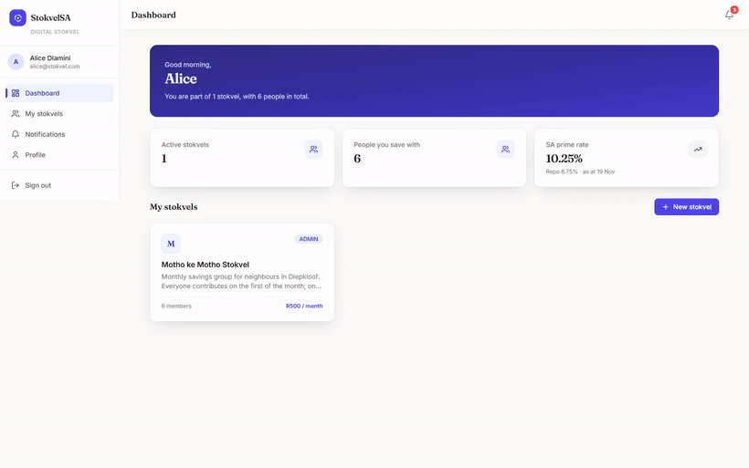

Every screenshot and recording in this README was taken from the application running against a seeded database — a Vite dev server in front of the Express API, signing in with a real Supabase account. Nothing below is a mockup.

---

## Table of contents

- [What it does](#what-it-does)
- [Routes](#routes)
- [Screens from the running system](#screens-from-the-running-system)
- [Demo accounts](#demo-accounts)
- [Reproducing the demo](#reproducing-the-demo)
- [Technology stack](#technology-stack)
- [Architecture](#architecture)
- [Getting started](#getting-started)
- [Useful commands](#useful-commands)
- [Continuous integration](#continuous-integration)
- [Security notes](#security-notes)
- [Deployment](#deployment)
- [Project structure](#project-structure)
- [Author](#author)

---

## What it does

- **Manage stokvel groups** — create groups, configure contribution amounts and frequencies, set payout order, and invite members.
- **Support group roles** — assign an Administrator, Treasurer or Member role within each group.
- **Track contributions** — record contribution periods and statuses, including pending, confirmed, late and missed contributions.
- **Coordinate payouts** — maintain payout schedules, recipients and processing statuses.
- **Organise meetings** — schedule group meetings, record meeting details and manage attendance.
- **Keep members informed** — provide notifications for contribution, payout and meeting activity, with scheduled reminder jobs.
- **View group analytics** — review group activity and export reports.
- **Use South African context** — retrieve and cache local interest-rate information for savings-related features.
- **Support online payment workflows** — initiate PayFast Sandbox payments and process payment notifications (ITNs).

## Routes

| Route | Purpose |
|---|---|
| `/` | Landing page |
| `/login`, `/register` | Sign in and create an account |
| `/forgot-password`, `/reset-password` | Request and complete a password reset |
| `/dashboard` | Contribution and payout summary across groups |
| `/groups` | The groups the signed-in user belongs to |
| `/groups/new` | Create a stokvel |
| `/groups/:id` | Members, roles, invitations and group summary |
| `/groups/:id/contributions` | Contribution periods, with generation and confirmation for administrators and treasurers |
| `/groups/:id/payouts` | Payout schedule, scheduling and settlement |
| `/groups/:id/meetings` | Meeting schedule, creation and cancellation |
| `/groups/:id/analytics` | Compliance and payout reporting |
| `/join` | Accepts the invitation link sent by email |
| `/notifications` | Group and personal notifications |
| `/profile` | Personal details and password |

Anything behind sign-in is loaded on demand, so the first visit costs a fraction of the full application.

## Screens from the running system

### Before sign-in

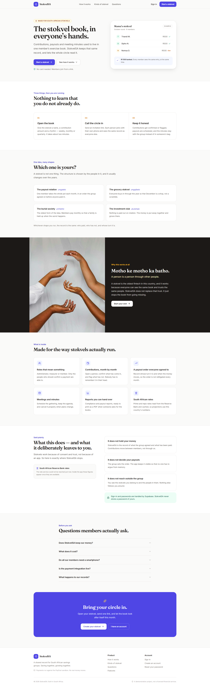

The landing page argues the product in one screen — a stokvel ledger with a treasurer's confirmation beside it — and then answers the questions people actually have about a savings app: whether it holds the money, who decides the payouts, and what happens to the record.

<table>
<tr>
<td width="50%">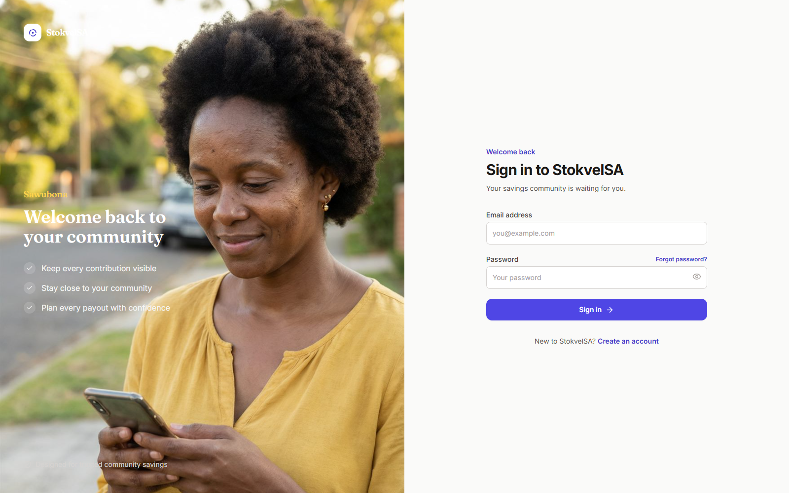<br/><sub><b>Sign in</b> — email and password against Supabase Auth; the account is a real one, not a demo mode.</sub></td>
<td width="50%"><br/><sub><b>Create an account</b> — name, email and password, with the invitation route for people joining a stokvel that already exists.</sub></td>
</tr>
</table>

### The workspace

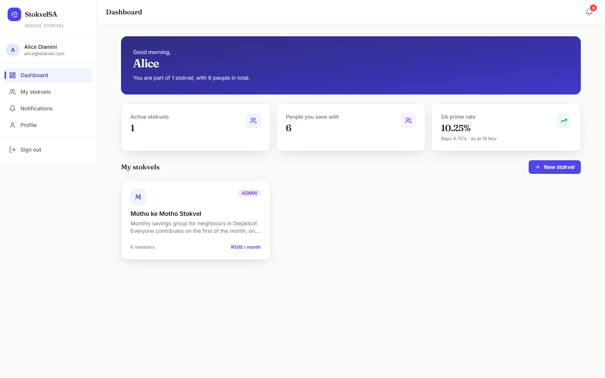

The dashboard answers the two things a member opens the app for: what am I part of, and where does this month stand. The rate card on the right is the cached South African prime rate that a background job refreshes, not a hard-coded number.

<table>
<tr>
<td width="50%">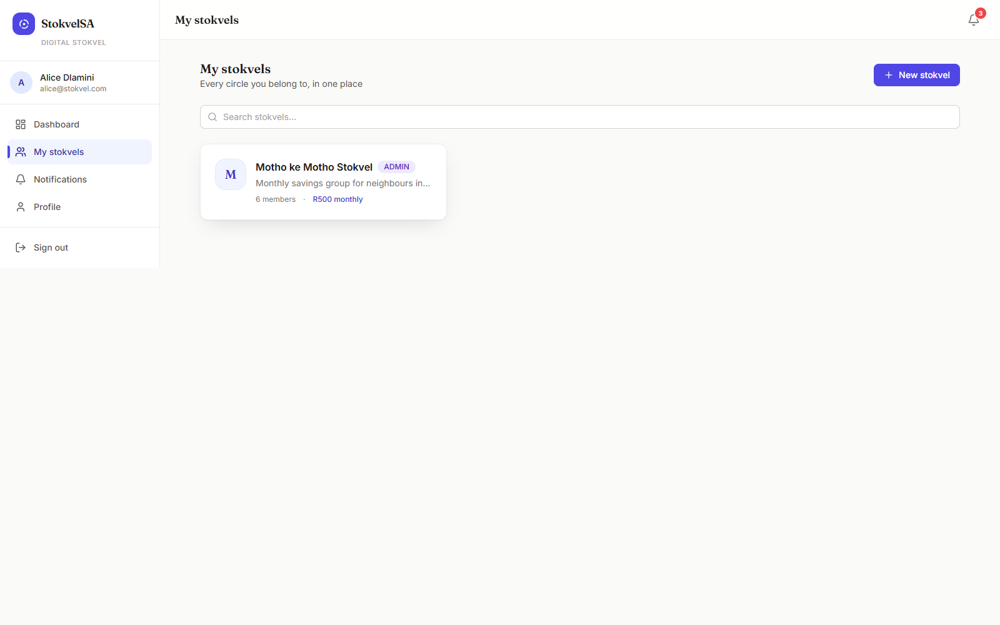<br/><sub><b>My stokvels</b> — one card per circle, carrying the member's role inside it.</sub></td>
<td width="50%">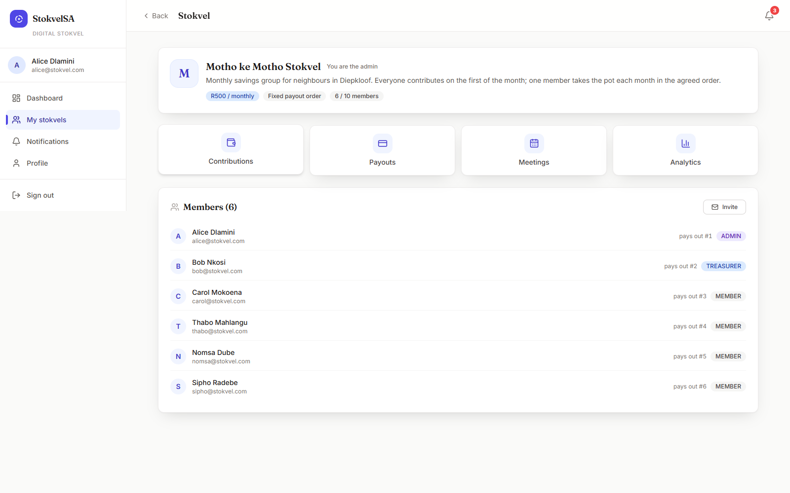<br/><sub><b>A stokvel</b> — who is in it, in what order they are paid, and the four things you can do inside it.</sub></td>
</tr>
</table>

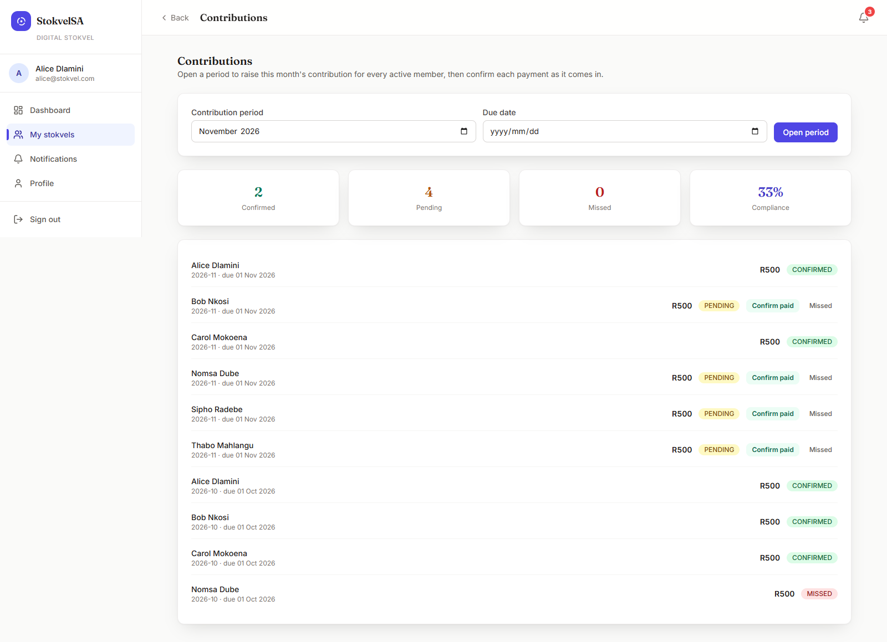

Contributions carry the group's actual financial state. Opening a period raises this month's contribution for every active member; from there a payment is confirmed or marked missed as it arrives. The tallies above the list are for the open period, which is why two confirmed payments read as 33% compliance in a group of six.

<table>
<tr>
<td width="50%">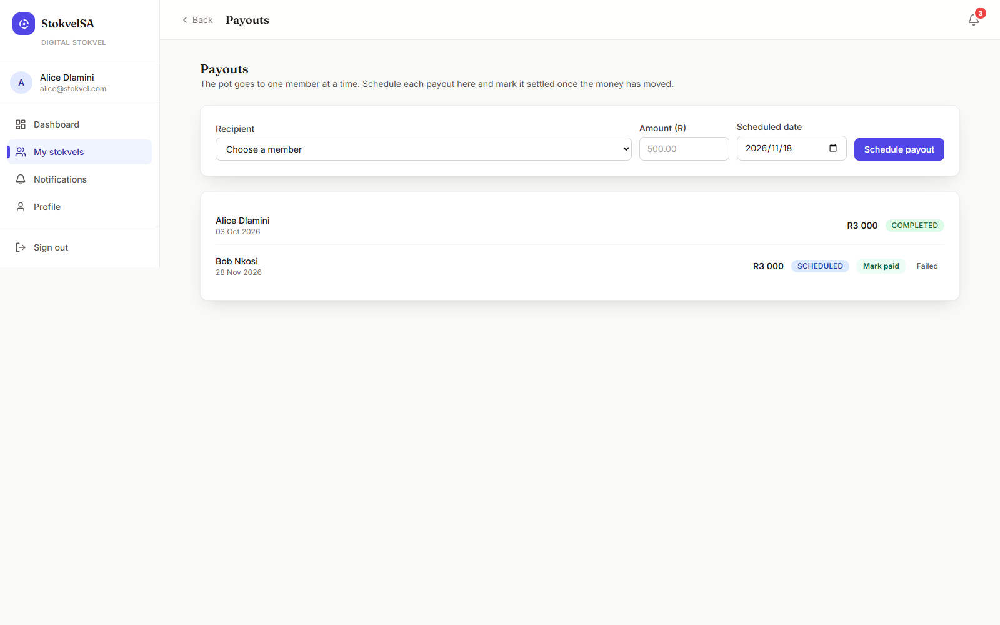<br/><sub><b>Payouts</b> — the pot goes to one member at a time; each payout is scheduled, then recorded as paid or failed.</sub></td>
<td width="50%">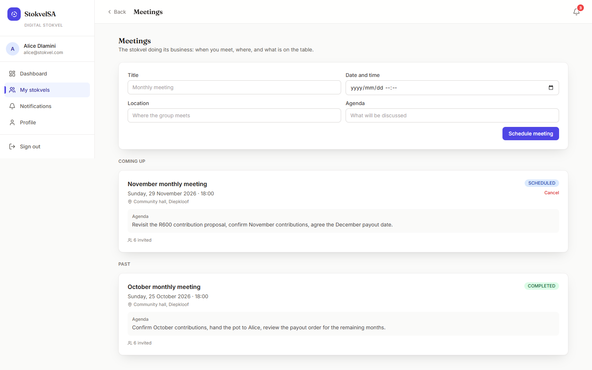<br/><sub><b>Meetings</b> — agenda, venue and minutes, with attendance and the past meetings kept alongside.</sub></td>
</tr>
<tr>
<td width="50%">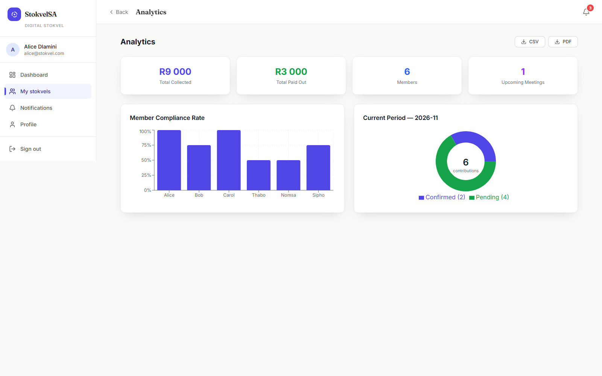<br/><sub><b>Analytics</b> — compliance per member and the current period at a glance, exported to CSV or PDF.</sub></td>
<td width="50%">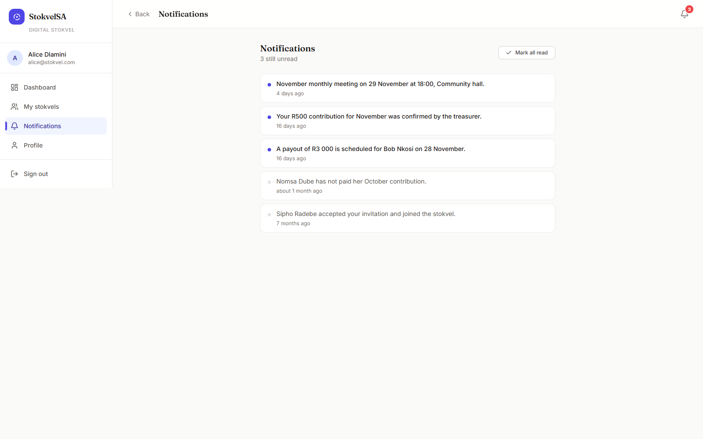<br/><sub><b>Notifications</b> — what changed, written in the terms the group uses.</sub></td>
</tr>
<tr>
<td width="50%">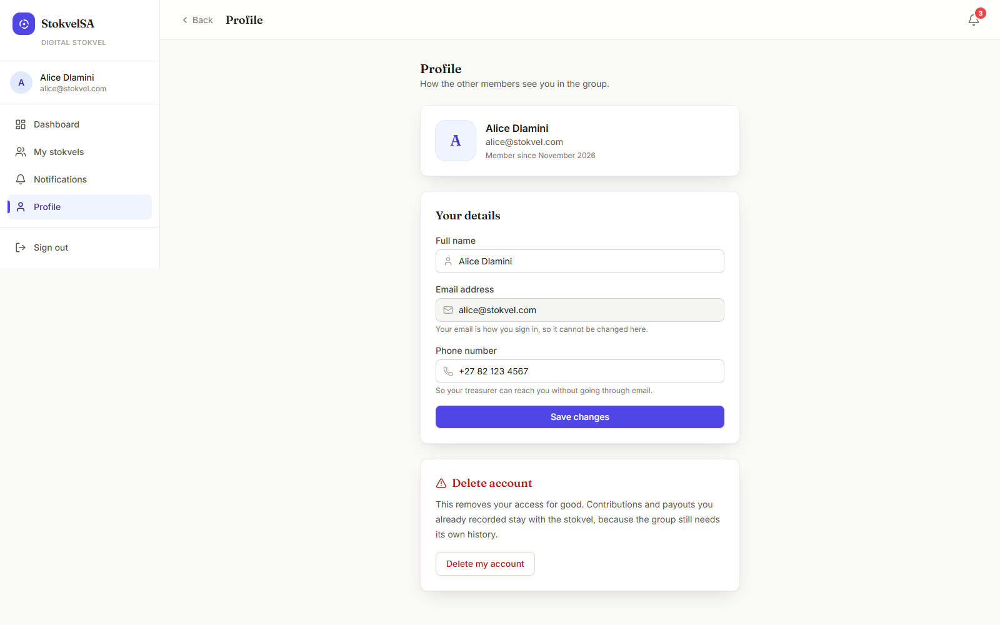<br/><sub><b>Profile</b> — your details as the group sees them; the email is fixed because it is how you sign in.</sub></td>
<td width="50%"><br/><sub><b>Password reset</b> — the recovery link lands on a page that sets the password rather than signing you in and abandoning you.</sub></td>
</tr>
</table>

### Screen recording

| Recording | What it shows |
| --- | --- |
| [Member tour](docs/media/video/stokvel-member-tour.mp4) ([webm](docs/media/video/stokvel-member-tour.webm)) | Sign-in, dashboard, the stokvel list, the stokvel and its members, contributions, payouts, meetings, analytics, notifications and profile |

---

## Demo accounts

The seeded dataset is one stokvel, **Motho ke Motho Stokvel**, with six people in it. Each has a different role and a different place in the payout order, which is what makes the screens above differ from one another.

| Person | Email | In the stokvel |
| --- | --- | --- |
| Alice Diamini | `alice@stokvel.com` | Administrator, paid out first |
| Bob Nkosi | `bob@stokvel.com` | Treasurer |
| Carol Mokoena | `carol@stokvel.com` | Member |
| Thabo Mahlangu | `thabo@stokvel.com` | Member |
| Nomsa Dube | `nomsa@stokvel.com` | Member |
| Sipho Radebe | `sipho@stokvel.com` | Member |

All six sign in with the value of `SEED_PASSWORD` in `Backend/.env`. They are ordinary Supabase accounts reached through the ordinary form — there is no demo mode, and nothing is stubbed for the screenshots.

The activity is arranged to exercise the awkward cases as well as the happy path: the open November period has two confirmed contributions and four still pending, October carries a missed one, and the payout schedule holds one completed payout and one still scheduled.

## Reproducing the demo

```bash
cd Backend
npm run db:seed:demo
```

`npm run db:seed` is the original seed, and it starts by clearing the users and groups tables — right on an empty database, destructive on one that already holds accounts. `prisma/seed-demo.js` is the additive alternative these screenshots were taken against: it skips any address that already exists, and when it finds the demo stokvel it rebuilds only that stokvel's own activity — contributions, payouts, meetings, notifications — leaving every other row alone. Running it a second time duplicates nothing.

The media is not hand-captured either. A Playwright script in a neighbouring workspace drives the running app, takes the screenshots and records the tour; this repository holds the output in `docs/media/`.


## Technology stack

| Area | Technologies |
|---|---|
| Frontend | React 19, Vite, React Router, Tailwind CSS |
| Client state and data | Zustand, TanStack Query, Axios |
| Charts and UI | Recharts, Lucide React, React Hot Toast |
| Backend | Node.js, Express 5 |
| Database | PostgreSQL, Prisma ORM |
| Authentication | Supabase Auth |
| Payments | PayFast Sandbox |
| Background jobs | node-cron |
| Reporting | PDFKit |
| Email and logging | EmailJS, Winston |
| Testing and code quality | Jest, ESLint, Prettier |
| Continuous integration | GitHub Actions |

## Architecture

StokvelSA is organised as a frontend application communicating with a REST API:

```text
StokvelSA/
├── Frontend/
│   ├── src/
│   │   ├── components/     # Shared layout and UI components
│   │   ├── lib/            # API client and Supabase client
│   │   ├── pages/          # Landing, auth, groups, contributions, etc.
│   │   └── stores/         # Client-side authentication state
│   └── package.json
│
└── Backend/
    ├── src/
    │   ├── config/         # Database, environment and service setup
    │   ├── controllers/    # HTTP request handlers
    │   ├── middleware/     # Authentication, validation and error handling
    │   ├── routes/         # REST API route definitions
    │   ├── services/       # Application and business logic
    │   ├── jobs/           # Scheduled reminders and rate refresh
    │   └── utils/          # Shared utilities
    ├── prisma/
    │   └── schema.prisma   # Relational data model
    └── package.json
```

The backend follows a layered structure:

```text
HTTP request
    ↓
Route + middleware
    ↓
Controller
    ↓
Service (business rules)
    ↓
Prisma ORM
    ↓
PostgreSQL
```

The database models users, groups, group memberships, contributions, payouts, meetings, attendance, invitations, notifications and cached interest rates. A member's role is stored on their membership in a particular group, allowing the same person to have different responsibilities in different stokvels.

## Getting started

### Prerequisites

- Node.js (use a current LTS release)
- npm
- A PostgreSQL database
- A Supabase project for authentication
- PayFast Sandbox credentials if you want to test the payment flow

### 1. Clone the repository

```bash
git clone https://github.com/PhumudzoManenzhe/StokvelSA.git
cd StokvelSA
```

### 2. Configure and start the backend

```bash
cd Backend
npm install
```

Create your local environment file from the example:

**macOS / Linux**
```bash
cp .env.example .env
```

**Windows PowerShell**
```powershell
Copy-Item .env.example .env
```

Set the values in `Backend/.env` for your environment. The API refuses to start without the first four, so configure them before anything else:

- `DATABASE_URL` and `DIRECT_URL` for PostgreSQL.
- `SUPABASE_URL`, `SUPABASE_ANON_KEY` and `SUPABASE_SERVICE_KEY`. The service key is used to verify tokens and to create accounts during seeding, and must never reach the browser.
- Email settings, if you want invitations and reminders to be delivered rather than logged as skipped.
- PayFast Sandbox credentials, keeping `PAYFAST_SANDBOX=true` while developing.

Generate the Prisma client and apply the database migrations:

```bash
npx prisma generate
npm run db:migrate
```

Load the demo data:

```bash
npm run db:seed:demo
```

The demo seed creates six people — an administrator, a treasurer and four members — inside one stokvel, in Supabase Auth as well as in the database, so they can actually sign in. All six use the password in `SEED_PASSWORD`, which defaults to `Stokvel2026!`. Use `npm run db:seed` instead only on a database you do not mind clearing, because it begins by deleting existing users and groups. Without Supabase credentials either seed still writes the profiles, but says plainly that they cannot be used to log in.

Start the API in development mode:

```bash
npm run dev
```

The API runs on `http://localhost:3000` by default. Its health endpoint is `http://localhost:3000/health`.

### 3. Configure and start the frontend

Open a second terminal:

```bash
cd Frontend
npm install
```

Create `Frontend/.env` using `Frontend/.env.example` as a guide and set:

- `VITE_API_URL` — the backend API base URL (for local development, use `http://localhost:3000`).
- `VITE_SUPABASE_URL` — your Supabase project URL.
- `VITE_SUPABASE_ANON_KEY` — your Supabase public/anon key.

Start the Vite development server:

```bash
npm run dev
```

Vite prints the local frontend URL in the terminal (normally `http://localhost:5173`).

## Useful commands

Run commands from the relevant directory.

**Backend** (`cd Backend`)

| Command | Description |
|---|---|
| `npm run dev` | Start the API with Nodemon |
| `npm start` | Start the API |
| `npm test` | Run the Jest test suite |
| `npm run lint` | Lint backend source files |
| `npm run db:migrate` | Create and apply a development migration |
| `npm run db:push` | Push the Prisma schema to the database |
| `npm run db:seed` | Load the demo group, members and activity — clears existing users and groups first |
| `npm run db:seed:demo` | Add the six-person demo stokvel without touching rows it did not create |
| `npm run db:studio` | Open Prisma Studio |

**Frontend** (`cd Frontend`)

| Command | Description |
|---|---|
| `npm run dev` | Start the Vite development server |
| `npm run build` | Build the frontend for production |
| `npm run preview` | Preview the production build locally |
| `npm run lint` | Run ESLint |

## Continuous integration

`.github/workflows/ci.yml` runs on every push and pull request. It lints and tests the API with Jest, then lints and builds the client. The build step matters because it runs on Linux: an import whose capitalisation only happens to match on a case-insensitive filesystem will fail there.

## Security notes

- Do not commit `.env` files, database URLs, Supabase service-role keys or payment credentials.
- Use the Supabase public/anon key in the browser; keep service-role and other privileged secrets on the server.
- Keep PayFast in Sandbox mode while developing and testing.
- Configure the backend's `FRONTEND_URL` to the actual frontend origin before deployment.
- Review authentication, authorization, database access policies and payment-webhook configuration before any production use.

## Deployment

The repository includes a Render service configuration at `Backend/render.yaml` for the API. The frontend is a separate Vite application and needs its own static-site hosting configuration.

Before deploying, configure all required environment variables in the hosting providers, set the correct frontend origin in `FRONTEND_URL`, set `VITE_API_URL` to the deployed API URL, and verify the `/health` endpoint. Do not assume a deployment is live until it has been deployed and tested.

## Project structure

- `Frontend/` — React web application.
- `Backend/` — Express REST API and background jobs.
- `Backend/prisma/` — Prisma schema, migrations and seed utilities.
- `Backend/tests/` — backend automated tests.
- `docs/media/` — the screenshots, GIF and recordings used in this README.

## Author

**Phumudzo Manenzhe**

- GitHub: [@PhumudzoManenzhe](https://github.com/PhumudzoManenzhe)

---

*StokvelSA — saving together, growing together.*
